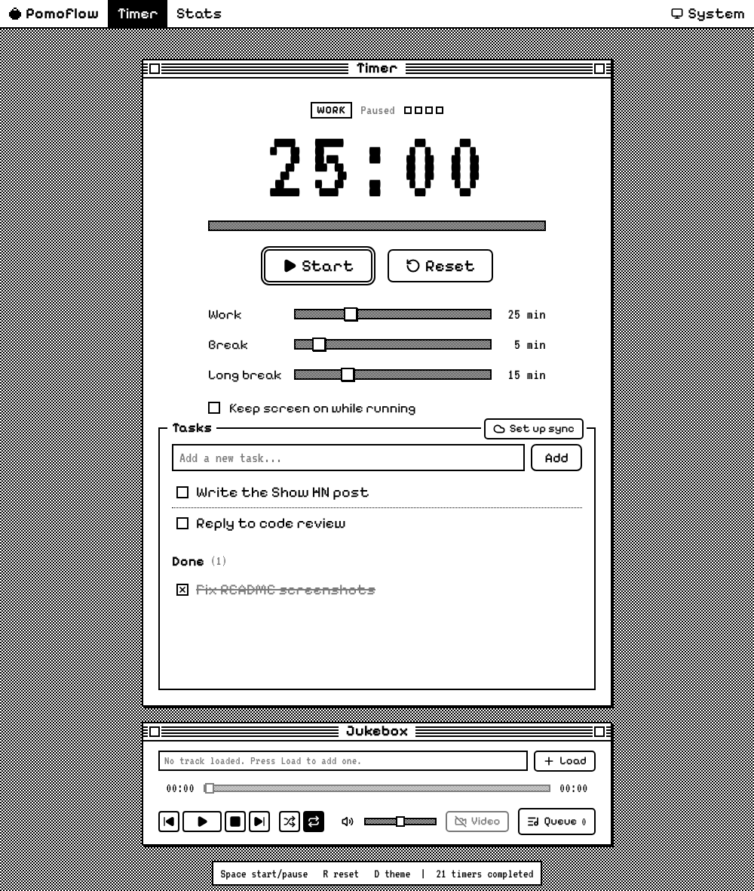
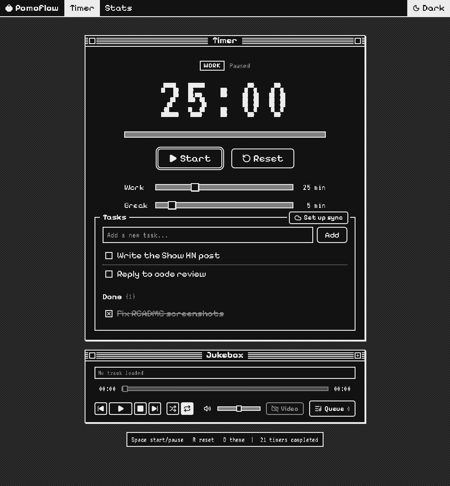
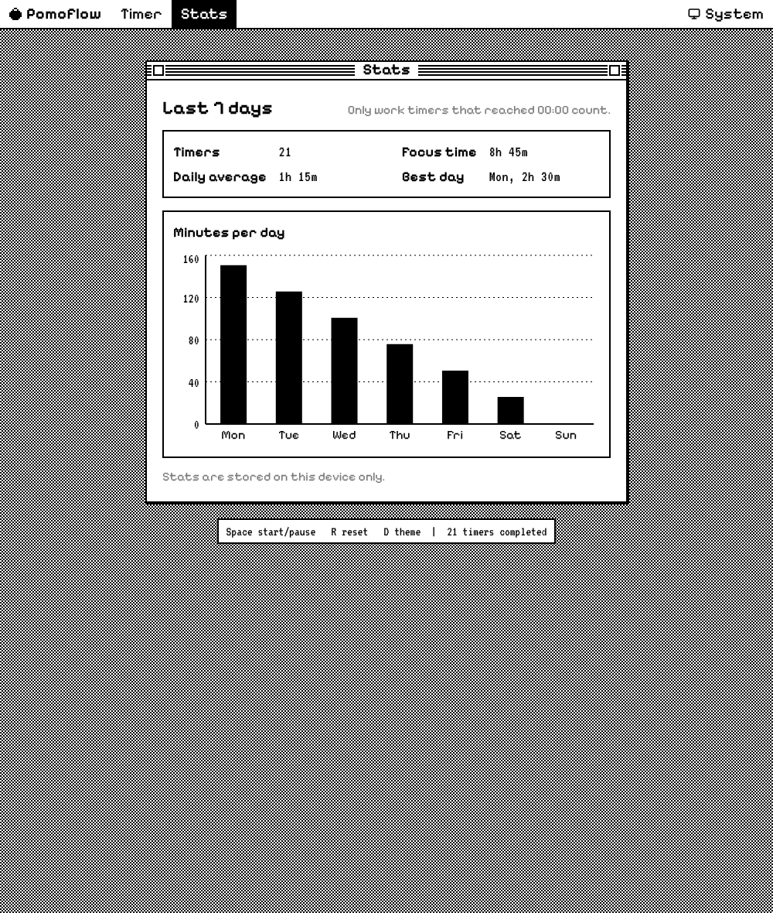

# Pomoflow

[](https://github.com/amoslives/pomoflow/actions/workflows/ci.yml)
[](./LICENSE)

A one-bit Pomodoro timer. Tasks, optional YouTube playback, weekly focus stats, and encrypted cross-device sync by scanning a QR code. No account or Pomoflow analytics.

**Try it:** [pomoflow.pages.dev](https://pomoflow.pages.dev)


## What it does

- Work and break timers with a completion chime and best-effort browser notifications. Countdown uses an absolute deadline and survives refresh, pause and app relaunch. Suspended browsers catch up when they resume; they cannot guarantee an alarm while suspended. Only the session actually started earns credit, then the next cycle begins.
- A task list that syncs between your devices. Pair a device by scanning a QR code or opening a link. There is no sign-up.
- YouTube videos, playlists and live streams, with a queue, shuffle, repeat and seeking. The video is hidden by default so playback runs from the media bar alone; press **Video** to show the player. Playback position survives a refresh, and music keeps playing when you switch to another app unless the browser or YouTube pauses it. The iOS home screen app stops music in the background; when you return, it resumes from where it stopped.
- Seven-day focus stats counted from work timers that reached 00:00. Pausing or resetting does not count.
- Light, dark and system themes in a classic desktop look. Keyboard shortcuts: `Space` start or pause, `R` reset, `D` theme.
- Installs as an app with its own window and launcher icon: **Install** in Chrome or Edge, **Add to Dock** in Safari on a Mac, **Add to Home Screen** on iPhone and Android.

<p>
  
  
</p>



## How sync works

There are no user accounts. Devices that share a *sync key* share one task list.

- **Generate secure key** creates a random 128-bit secret (`pf2-` plus 26 base32 characters).
- Pair another device by scanning the QR code or opening the pairing link. The secret travels in the URL fragment (`#sync=...`) and is removed from the address bar. Query-string pairing is no longer accepted. Confirm **Use room tasks only** or explicitly **Merge and share my tasks**. Opening a link alone never switches rooms or uploads tasks. A previous-list backup stays in local storage under `pomodoro_pairing_backup_<timestamp>`.
- The browser encrypts the task snapshot using AES-GCM with a fresh 96-bit nonce for each write. Domain-separated SHA-256 derivations produce the AES key and a separate bearer credential. The server receives that credential and ciphertext, never the pairing secret or the AES key. D1 stores a hash of the bearer credential, the encrypted snapshot and its revision.
- Each device saves unacknowledged edits locally. A sync reads the latest snapshot, reapplies those edits, and writes with a revision check. Deletions leave the shared snapshot after acknowledgement; idle devices do not re-upload their old copies. Concurrent edits to the same task are resolved by the last accepted write.
- Task titles are limited to 500 characters. The encrypted document is limited to 1.8 MB; the old 500-lifetime-task limit is gone. Oversized existing data stays local with an actionable error until edited or deleted. Records are never silently dropped to fit.
- **Rotate secure key** copies your tasks to a new encrypted room and permanently revokes the old credential. Other devices show a revoked-key error and must pair with the new link. Rotation checks the old revision to avoid losing simultaneous edits. It cannot erase copies somebody already downloaded.
- Legacy keys are read-only recovery sources. Weak keys cannot read rooms; rotate using the tasks already saved on your device. For old random `pf-` keys, rotation first retrieves the legacy room, encrypts it with a new secret, then revokes and clears the old room. Migration removes the KV copy after D1 has stored it. Unmigrated legacy rooms remain plaintext until rotated or deleted.
- On iPhone and iPad, an app added to the Home Screen keeps its own storage, separate from Safari, and pairing links open in Safari. Pair it by pasting the pairing link into **Sync key**.

The key is a capability. Anyone who has it can read and change that task list, so share pairing links only with devices you control and never paste one into an issue, screenshot or chat. Sync is optional. Without a key, tasks stay in the browser.

Encryption protects new task snapshots in transit through the API and at rest in D1. Devices keep local tasks and pairing secrets in browser storage. You still trust the deployed JavaScript and the devices you pair; a compromised deployment could change that JavaScript. The server sees request timing, IP addresses and document sizes. A D1-backed limit permits 120 requests per IP per minute across isolates.

## Third-party connections

YouTube is loaded only when you play or load a source. Its privacy-enhanced embed may still collect playback data and use cookies. Google Fonts loads the UI fonts. These services receive network information such as your IP address. Pomoflow itself adds no analytics scripts. See [Google's privacy policy](https://policies.google.com/privacy) and [YouTube's terms](https://www.youtube.com/t/terms).

## Tech stack

- React 19, TypeScript, Vite and Tailwind CSS v4
- Recharts for the stats chart, loaded only when the Stats view opens
- YouTube IFrame Player API, Web Audio for the chime
- Express for local development, Cloudflare Pages Functions and D1 in production
- Node's native test runner for unit and API tests, Playwright for desktop and mobile browser tests

## Local development

Requires Node.js 24 or newer and npm.

```bash
git clone https://github.com/amoslives/pomoflow.git
cd pomoflow
npm install
npm run dev
```

Open [http://localhost:3000](http://localhost:3000). The dev server serves the app and the `/api/tasks` sync API; local sync data lives in the gitignored `.data/tasks.sqlite`. The server imports the old `.data/tasks.json` once and keeps it as a local backup. Both environments execute the same API handler and SQL migrations.

## Checks

```bash
npm run lint      # strict TypeScript
npm test          # unit and API contract tests
npm run test:e2e  # Playwright, desktop and mobile Chromium
npm run check     # all of the above plus a production build
```

Pull requests and pushes to `main` run the same checks in GitHub Actions. Cloudflare Pages builds a preview for every branch.

## Deployment

`wrangler.toml` is the source of truth for the Cloudflare Pages configuration.

- `TASKS_DB`: the D1 database that stores sync rooms
- `TASKS_KV`: migration source for legacy rooms; migrated entries are deleted
- `migrations/`: D1 schema history

The identifiers in `wrangler.toml` are not credentials. Cloudflare API tokens and pairing links must never be committed.

Apply migrations to the production D1 database **before deploying this release**:

```bash
npx wrangler d1 migrations apply pomoflow-sync --remote
```

Migration `0002_revocation_and_rate_limits.sql` adds persistent revocations and shared rate-limit counters. Existing clients must reload, rotate legacy keys, and re-pair their other devices. Deployments using separate preview D1 databases need the same migrations applied there.

## Security

Report vulnerabilities privately; see [SECURITY.md](./SECURITY.md). Do not include a pairing key or private task data in a report.

## License

[Apache License 2.0](./LICENSE)
